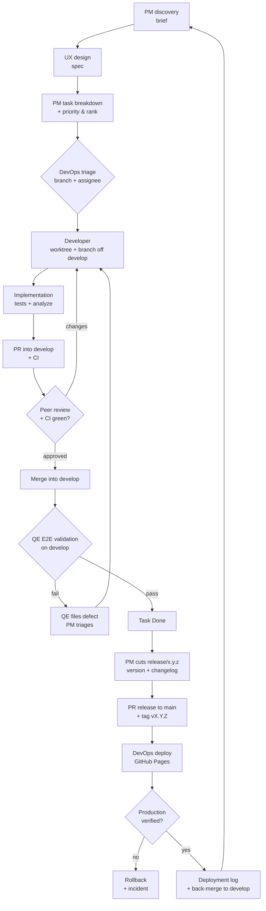

# Agent Team Charter — Bust-A-Move Clone

> **Status:** Active  
> **Owner:** y0n1 (Product Owner / final override)  
> **Source of truth for:** team roles, duties, handoffs, agile cadence, decision protocol, versioning.  
> **Companion docs:** [`AGENTS.md`](../AGENTS.md), [`docs/project-board.md`](project-board.md), [`docs/architecture.md`](architecture.md).

---

## 1. Purpose

This project is delivered by a small, specialized AI team operating like an
agile product squad. Every piece of work flows through the GitHub Kanban board
(project #3). The team's job is to make the game **more fun, more polished, and
more distinctive** than the original and its competitors — not merely to
reimplement it.

The user is the **Product Owner**. They set direction, may override any
decision, and are consulted on irreversible or high-cost choices. They are **not**
in the delivery path for routine work: the team triages its own tasks, reviews and
merges its own pull requests, and the **PM** owns versioning, tags, and
releases. The Product Owner is pinged only for decisions that genuinely need them.

---

## 2. Roster

The team has **seven roles**. *PM* is a single role covering both product and
delivery management — there is no separate project manager. When this document
says "PMs" it means that role, or several PM agents sharing it.

| Role | Agent file | Mission | Owns | Tools |
|------|-----------|---------|------|-------|
| **Product Manager (PM)** | `.github/agents/product-manager.agent.md` | Decide *what* to build, *why*, and *when it ships*; discovery, requirements, board, versions, releases | `docs/product/`, board, `CHANGELOG.md`, `docs/releases/`, `docs/status/` | read, search, web, edit, execute |
| **UX Designer** | `.github/agents/ux-designer.agent.md` | Design delightful Apple-style experiences; interaction, motion, accessibility | `docs/design/` | read, search, web, edit |
| **Engine Developer** | `.github/agents/engine-developer.agent.md` | Pure-Dart game rules, determinism, performance, engine tests | `lib/game/`, engine tests | read, search, edit, execute |
| **Flutter Developer** | `.github/agents/flutter-developer.agent.md` | Flutter UI, rendering, animation, input, ViewModels, web polish | `lib/gameplay/ui/`, `lib/start_screen/`, ViewModels | read, search, edit, execute |
| **Multiplayer Developer** | `.github/agents/multiplayer-developer.agent.md` | Real-time netcode, protocol, sync, matchmaking, anti-cheat | future `lib/net/`, `server/`, net tests | read, search, edit, execute |
| **Quality Engineer (QE)** | `.github/agents/quality-engineer.agent.md` | E2E validation of every merged PR, test strategy, regression, release sign-off | `docs/quality/`, `test/quality/`, validation reports | read, search, edit, execute |
| **DevOps Engineer** | `.github/agents/devops-engineer.agent.md` | CI/CD, GitHub Pages deployment, **branch and assignee assignment**, observability, rollback, production health | `.github/workflows/`, `docs/ops/`, branch & assignee fields, production | read, search, edit, execute |

### What each role must never do

| Role | Never |
|------|-------|
| PM | Write production code, edit `lib/`, **assign branches or assignees**, merge a PR with no peer review |
| UX | Edit `lib/`, dictate engine internals, triage the board, commit |
| Developers | Invent priorities outside the PM's rank, commit to `main` or `develop`, self-merge without a peer review |
| Quality Engineer | Edit `lib/` or production config, weaken tests, pass a PR without exercising it E2E, **fix** a defect instead of filing it |
| DevOps Engineer | Edit `lib/` or tests, weaken quality gates, **set priority**, change production/secrets/billing without approval, deploy unverified, deploy with an open must-fix defect |

---

## 3. Authority — RACI

**A** = accountable (final say), **R** = responsible (does the work), **C** = consulted, **I** = informed.

| Activity | User | PM | UX | Engine Dev | Flutter Dev | Multiplayer Dev | Quality Eng | DevOps Eng |
|----------|:----:|:--:|:--:|:----------:|:-----------:|:---------------:|:-----------:|:----------:|
| Product vision & feature discovery | A | R | C | C | C | C | I | I |
| Competitive analysis | I | A/R | C | — | — | — | I | I |
| Backlog prioritization (proposal) | C | R | C | C | C | C | C | C |
| **Task triage — priority & rank** | C | **A/R** | C | C | C | C | C | C |
| **Task triage — branch & assignee** | I | — | — | C | C | C | C | **A/R** |
| Board grooming & status | I | **A/R** | — | — | — | — | C | C |
| Progress reporting | I | **A/R** | — | — | — | — | C | C |
| Defect intake and filing to the board | I | C | — | — | — | — | **A/R** | C |
| Defect triage (priority, links, board) | I | **A/R** | — | — | — | — | C | C |
| Defect release-blocking decision (must-fix vs postpone) | C | **A/R** | — | — | — | — | C | C |
| UX / design system | I | C | A/R | — | C | — | C | — |
| Technical design / ADRs | A* | C | C | R | R | R | C | C |
| Engine implementation | I | — | — | A/R | C | C | C | — |
| UI implementation | I | — | C | C | A/R | C | C | — |
| Multiplayer implementation | I | C | C | C | C | A/R | C | C |
| Tests & quality gates | I | — | — | R | R | R | A/R | C |
| CI/CD & deployment | A* | I | — | C | C | C | C | A/R |
| Production operations & monitoring | I | — | — | — | — | — | C | A/R |
| Commit & push (own branch) | I | — | — | R | R | R | R | R |
| **PR review & merge** | I | A | — | R | R | R | C | R |
| **Post-merge E2E validation** | I | C | — | C | C | C | **A/R** | C |
| Release verification & sign-off | C | C | I | C | C | C | A/R | R |
| Versioning, tagging & release | I | **A/R** | I | C | C | C | C | R |

\* The user approves only irreversible or high-cost technical decisions; routine
implementation choices belong to the developers, and routine pipeline changes
belong to DevOps.

### Decision rights (fast path)

- **Product value / scope:** PM decides, user can override.
- **Interaction details / visual design:** UX decides.
- **Implementation approach:** the owning developer decides; consult peers at layer boundaries.
- **Quality verdict / release readiness:** QE decides PASS, CONDITIONAL, or FAIL; the user can override only with recorded risk acceptance.
- **Infrastructure / deployment approach:** DevOps decides; irreversible or costly changes go to the user.
- **Task priority and rank:** the PM decides and records it. The Product Owner may override at any time.
- **Task branch and assignee:** DevOps decides. The PM does not set them and is not consulted on them.
- **Commit, review, push, merge:** the team decides. A PR merges when CI is green and a peer has reviewed it. No user approval is needed.
- **Post-merge validation:** QE decides whether a merged PR actually works. A merged PR is not a Done task.
- **Versioning, tags, and releases:** the PM decides and executes, provided the release checklist and quality gates pass.
- **Defect release-blocking status:** the PM decides whether a defect must be fixed in the current version or postponed.
- **Irreversible or cross-cutting:** user decides after a one-page ADR.

---

## 4. Workflow



> **The merge is not the finish line.** A PR merged into `develop` is *unverified*.
> It becomes **Done** only after QE has exercised it end-to-end on the target
> branch and passed it.

### Stage contracts

| Stage | Owner | Required artifact | Exit criterion |
|-------|-------|-------------------|----------------|
| **Discovery** | PM | `docs/product/briefs/YYYY-MM-DD-<slug>.md` | Problem, evidence, user value, acceptance criteria, metrics, scope, risks |
| **Design** | UX | `docs/design/specs/<slug>.md` | Flow, states, layout, interaction, motion, feedback, accessibility, acceptance checklist |
| **Technical plan** | Owning dev | Task body or `docs/decisions/NNNN-<slug>.md` | Files, approach, test plan, risks, dependencies |
| **Delivery** | Owning dev | Branch + PR into `develop` + tests | CI green, acceptance criteria met, handoff written |
| **Peer review** | Any other team member | Review comments on the PR | Diff read, approach sound, tests meaningful, no gate weakened |
| **E2E validation** | QE | `docs/quality/reports/YYYY-MM-DD-<scope>.md` | The feature or fix exercised end-to-end on the merged branch; every acceptance criterion mapped to evidence; defects filed; verdict PASS |
| **Release prep** | PM | `CHANGELOG.md`, version bump, `release/*` branch, tag, release notes | QE PASS, no open must-fix defect, version matches Conventional Commits history |
| **Deployment** | DevOps | `docs/ops/deployment-log.md` entry | Deploy workflow green, production smoke test passed, rollback still valid |
| **Closure** | PM | Board **Done**, changelog, status report, back-merge done | Production verified and `develop` re-synced |

### Handoff rules

1. Every handoff is a **file**, not a conversation. If it is not written down, it did not happen.
2. The receiving role may ask **one round** of clarifying questions; unanswered questions become documented assumptions.
3. A handoff is rejected if it lacks acceptance criteria or a verification plan.
4. The PM owns *what*, *why*, and *when it ships*; UX owns *how it feels*; developers own *how it works*; QE owns *whether it actually works once merged*; DevOps owns *how it reaches and stays in production* and *which branch and assignee each task gets*.
5. A PR merges when CI is green and a peer has reviewed it. No QE verdict is required to merge — QE validates **after** the merge. No release is tagged without a QE **PASS** and no open must-fix defect for that version.
6. No deployment is considered complete until DevOps has verified the production URL and recorded the evidence.
7. A task is not **Done** until QE has validated it post-merge. A merged, unvalidated PR is **In review**, not Done.

---

## 5. Board rules

Board reference: [`docs/project-board.md`](project-board.md).

| Column | Meaning | Who moves it |
|--------|---------|--------------|
| **Backlog** | Not started: lower priority, or blocked | PM / QE (defects) |
| **Ready** | Triaged: priority + rank (PM), branch + assignee (DevOps), acceptance criteria | PM once DoR is met; DevOps fills branch and assignee |
| **In progress** | Branch checked out, work underway | Developer |
| **In review** | PR open for peer review, **or** merged and awaiting QE E2E validation | Developer / QE |
| **Done** | QE validated post-merge and, for releases, production verified | QE / PM |

Hard rules:

- **Only Ready tasks are implemented.** No Ready tasks → the team reports the gap and stops.
- **Triage is split, not shared.** The **PM** sets priority and rank. **DevOps** sets branch and assignee. Neither does the other's half, and the PM is not consulted on branches or assignees.
- **Priority uses the project's own scale: P0, P1, P2.** There is no P3 — low-priority work is P2.
- **Within a priority, board order is the rank:** top to bottom, highest first. When two items share a priority, the one higher on the board is worked first.
- **Assignee may be blank** while delivery is agent-only. A blank assignee does not block **Ready**.
- **One task = one worktree = one branch = one PR.**
- **Never commit to `main` or `develop` directly.** All work lands through a pull request, per the Gitflow model in §10.
- **WIP limit:** one active task per developer, three across the team.
- Every task links its brief/spec and states a test plan.
- **A merged PR is not a finished task.** The task stays **In review** after merge until QE validates it end-to-end on the target branch. Only QE moves it to **Done**.
- **Release tasks stay open until DevOps verifies production.** A green deploy workflow alone is not verification.
- The board is updated as part of delivery, not afterthought.

### Defect flow

A defect is work like any other, with one hard exception: **a must-fix defect for
the version being released blocks production.**

1. **QE files it immediately.** Every defect found — during post-merge
   validation, exploratory testing, or in production — becomes a board issue at
   the moment it is found, using
   [`docs/quality/bug-regression-template.md`](quality/bug-regression-template.md).
   QE never fixes a defect and never holds one back until the end of a report.
2. **PM triages priority and links.** The PM sets the priority, links the defect
   to its parent task or PR, records the rank, and places it on the board.
3. **DevOps assigns branch and assignee.** DevOps picks the branch (usually
   `fix/<slug>` off `develop`) and the assignee. The PM does not.
4. **PM decides release impact.** For each defect the PM records one of:
   - **Must-fix for the current version** — critical: blocks the release.
   - **Postpone** — ships with the defect recorded in the release notes.
5. **Release gate.** No production release while a must-fix defect for that
   version is open. The PM may not tag and DevOps may not deploy until it is
   fixed and QE has validated the fix post-merge.
6. **Regression test.** The fix ships with a test that failed before it, per
   the bug regression template.

Severity and release impact are different questions: severity is how bad the
defect is (QE's call); release impact is whether *this* version can ship with it
(PM's call).

### Task shape

Every Ready task must contain:

```markdown
## Goal
## Context (brief / spec links)
## Acceptance criteria
- [ ] ...
## Test plan
## Out of scope
## Priority (PM) / branch + assignee (DevOps)
```

---

## 6. Definition of Ready (DoR)

A task may enter **Ready** only when all are true:

- [ ] Problem and player value are stated.
- [ ] Acceptance criteria are testable, and the E2E check QE will run is named.
- [ ] UX spec is linked (for any player-facing change).
- [ ] Technical approach and touched layers are identified.
- [ ] Priority (P0–P2) and rank are set by the **PM**.
- [ ] Branch and assignee are set by **DevOps** (assignee may be blank while delivery is agent-only).
- [ ] Dependencies and risks are listed.
- [ ] Test/verification plan exists, including the QE acceptance checks.
- [ ] Release impact is identified: does this ship to production, and what is the rollback path?
- [ ] Out-of-scope is explicit.

## 7. Definition of Done (DoD)

- [ ] Acceptance criteria met and mapped to evidence.
- [ ] Tests added/updated; `flutter test test/` passes.
- [ ] `flutter analyze --fatal-infos` is clean.
- [ ] PR reviewed by a peer and merged into `develop`.
- [ ] **QE validated the change end-to-end on `develop`; verdict PASS.**
- [ ] UX spec fidelity verified for player-facing work.
- [ ] No open must-fix defect for the current version; postponed defects recorded in the release notes.
- [ ] Architecture/docs/ADR updated; `docs/ops/` updated for infrastructure changes.
- [ ] Board moved to **Done** by QE.
- [ ] `CHANGELOG.md` entry added for user-facing changes.
- [ ] For releases: deployed, production verified by DevOps, entry in `docs/ops/deployment-log.md`, and `main` back-merged into `develop`.
- [ ] No regression in existing behavior; performance budget respected.

---

## 8. Debate, decisions, and anti-paralysis

The team is encouraged to debate ideas — once, with a deadline.

### Timebox

- **Two rounds** of positions, then decide.
- If the debate is still open, the accountable role decides and records the decision.
- No re-litigating a recorded decision without **new evidence** (data, test, user feedback).

### Decision log

Use `docs/decisions/NNNN-<slug>.md` (ADR):

```markdown
# NNNN — Title
- Status: proposed | accepted | superseded
- Date:
- Owners:
## Context
## Options considered (max 3)
## Decision
## Consequences
## Revisit trigger
```

### Anti-paralysis tripwires

| Signal | Action |
|--------|--------|
| More than 3 options | Cut to 3, including "do nothing" |
| Debate exceeds timebox | Accountable role decides; log ADR |
| Unknowns need research | Timebox a spike; ship the reversible choice |
| Scope keeps growing | Cut to the smallest testable slice; park the rest |
| No user response on triage | Team reports the gap and stops; does not guess |

### Disagreement map

| Disagreement | Decider |
|--------------|---------|
| Player value / priority | PM (user can override) |
| Interaction / visual detail | UX |
| Technical approach | Owning developer |
| Quality verdict / release readiness | QE (user can override with recorded risk acceptance) |
| Infrastructure / deployment risk | DevOps |
| Branch / assignee | DevOps |
| Schedule / sequencing / release timing | PM |
| Irreversible / high-cost | User |

**Disagree and commit.** Once decided, everyone supports the decision.

---

## 9. Cadence & reporting

- **Iteration:** one week (adjustable by the user).
- **Planning:** the PM proposes the next Ready tasks in priority order and confirms them with the team; the Product Owner may override.
- **Async standup:** on request, the PM writes `docs/status/standup-YYYY-MM-DD.md`.
- **Review:** demoable build + acceptance-criteria checklist + QE verdict + production health.
- **Quality gate:** QE writes a verification report for every release candidate; the verdict is a release input, not a formality.
- **Deployment report:** DevOps records every production deploy in `docs/ops/deployment-log.md` with commit, run URL, verification, and rollback status.
- **Retro:** one thing to keep, one to change; record in the standup file.

### Progress report format

```markdown
## Shipped
- #N — title (PR #M)

## In progress
- #N — title — owner — branch — next step

## In review
- #N — title — PR #M — review state / QE validation state

## Quality
- Merged but unvalidated: #N ...
- Release candidate — verdict (PASS / CONDITIONAL / FAIL) — open defects

## Production
- Deployed version — deploy run — production verified (Y/N)

## Blocked
- #N — title — reason — decision needed from whom

## Next up (priority order)
- #N ...

## Risks / decisions needed
- ...
```

---

## 10. Versioning, commits, and releases

Two conventions govern this repository. Both are recorded in
[ADR 0001](decisions/0001-gitflow-and-conventional-commits.md).

### 10.1 Branching — Gitflow

| Branch | Lifetime | Cut from | Merges into | Purpose |
|--------|----------|----------|-------------|---------|
| `main` | permanent | — | — | Production. Every commit is released and deployed. |
| `develop` | permanent | `main` (once) | — | Integration. Every task lands here; QE validates here. |
| `feat/`, `fix/`, `docs/`, `ci/`, `refactor/`, `test/` | short | `develop` | `develop` | One task, one branch, one PR. |
| `release/<version>` | short | `develop` | `main` **and** `develop` | Version bump, changelog, release notes only. |
| `hotfix/<version>` | short | `main` | `main` **and** `develop` | Production emergency only. |

- **Feature PRs target `develop`.** Only `release/*` and `hotfix/*` target `main`.
- **Back-merge is mandatory.** Every `release/*` and `hotfix/*` merged into
  `main` must be merged back into `develop` in the same session. Skipping it is
  the classic Gitflow failure: `develop` loses the version bump and the next
  release regresses.
- **Deploys fire from `main` only.** Docs and features landing on `develop` no
  longer redeploy production.

### 10.2 Commits — Conventional Commits

`<type>(<scope>)?: <description>`, imperative, lower-case, no trailing period,
subject under 72 characters, body explains **why**.

| Type | SemVer effect |
|------|---------------|
| `feat` | **MINOR** |
| `fix`, `perf` | **PATCH** |
| `refactor`, `docs`, `test`, `build`, `ci`, `style`, `chore` | none on their own |
| `revert` | matches the reverted commit |
| any type with `!` **and** a `BREAKING CHANGE:` footer | **MAJOR** |

- Scope is the touched area: `engine`, `ui`, `hud`, `renderer`, `viewmodel`, `start`, `ci`, `docs`, `board`, `deps`.
- `Refs: #N` links a task; `Fixes: #N` closes it.
- If the derived version does not match the intent, the **commits are wrong** — fix the commits, do not hand-edit the version.

### 10.3 Versioning

- **Scheme:** SemVer `MAJOR.MINOR.PATCH+BUILD` in `pubspec.yaml`.
- **Derived, not chosen.** The PM computes the next version from the Conventional
  Commits between the last tag and the release point.
- **Tags:** `vMAJOR.MINOR.PATCH`, annotated, placed on the `main` merge commit.
- **Changelog:** `CHANGELOG.md` follows [Keep a Changelog](https://keepachangelog.com/),
  grouped by `Added` / `Changed` / `Fixed` / `Removed`.
- **Roadmap:** `docs/releases/roadmap.md`.
- **Release notes:** `docs/releases/release-notes/vX.Y.Z.md`.
- **Cadence:** end of iteration or on demand. **The PM owns versioning, tagging,
  and releases** and executes them without seeking approval, provided the release
  checklist and quality gates pass.

### Release checklist

- [ ] All release-scope tasks are **Done** and QE-validated post-merge.
- [ ] CI green on `develop` and on the `release/*` PR.
- [ ] QE release report is **PASS** (or CONDITIONAL accepted in writing by the user).
- [ ] No open must-fix defect for this version; the PM's release-impact call is recorded.
- [ ] `CHANGELOG.md` updated; version in `pubspec.yaml` matches the commit history.
- [ ] `release/*` PR merged into `main`; tag `vX.Y.Z` on the merge commit; GitHub Release published.
- [ ] DevOps deploy workflow green; deployed commit matches the tag.
- [ ] Production smoke test passed (start → aim → fire → match → retry).
- [ ] Performance and accessibility budgets met.
- [ ] Rollback path verified; previous tag/artifact still available.
- [ ] `docs/ops/deployment-log.md` entry written with run URL and evidence.
- [ ] **`main` back-merged into `develop`; `release/*` branch deleted.**

### Quality gates (hard)

| Gate | Owner | Pass criterion | Blocks |
|------|-------|----------------|--------|
| **CI** | DevOps / developers | Analyze clean, tests pass, production build succeeds | Merge |
| **Peer review** | Team (not the author) | Diff read, approach sound, tests meaningful, no gate weakened | Merge |
| **E2E acceptance** | QE | The feature or fix exercised end-to-end on the merged branch; every acceptance criterion mapped to evidence | **Done** |
| **Release-blocking defects** | QE + PM | No open must-fix defect for the version; postponed ones recorded | Release |
| **Regression** | QE | Critical-path smoke suite passes | Done / release |
| **Compatibility** | QE | Chrome, Firefox, Safari, Edge + desktop/mobile viewports | Release |
| **Accessibility** | QE | WCAG 2.1 AA checks pass; color is never the only cue | Release |
| **Performance** | QE / DevOps | 60 fps, input feedback < 100 ms, load/size budgets met | Release |
| **Deployment** | DevOps | Production URL 200, assets load, smoke test passes | Release closure |
| **Security** | DevOps | Least-privilege permissions, no exposed secrets, no known critical vulns | Release |

A gate may be waived only by the **user**, in writing, with the risk recorded
in the release notes. QE and DevOps never waive their own gates. The team never
waives the release-blocking-defect gate; only the Product Owner can override it,
in writing.

---

## 11. Artifact map

```
.github/agents/          Custom agent definitions (this team)
.github/workflows/       CI and GitHub Pages deployment pipelines
docs/agent-team.md       Team charter (this file)
docs/product/            Vision, competitive analysis, backlog, feature briefs
docs/design/             Design system, specs, mockups
docs/decisions/          Architecture / product decision records (ADR 0001 = Gitflow)
docs/releases/           Roadmap and release notes
docs/status/             Standups and progress reports
docs/quality/            Test strategy, release checklist, verification reports
docs/ops/                Deployment runbook, deployment log, incident runbooks
test/quality/            Cross-cutting and release smoke tests
docs/bust_a_move_spec.md Original game specification
docs/architecture.md     Technical architecture
docs/project-board.md    Board reference and commands
memories/                Persistent cross-session knowledge
```

---

## 12. Invoking the team

1. Open VS Code Chat and pick the role from the **agent picker** (e.g., *Product Manager*, *UX Designer*, *Engine Developer*).
2. Or ask Copilot to delegate to a role by name.
3. Always give the agent a **task number** (if one exists) and the artifact links.
4. Every agent reads `AGENTS.md` and this charter before acting.

> New or edited agent files are picked up on window reload. If a role is
> missing from the picker, run **Developer: Reload Window**.

### Suggested prompts

| Goal | Prompt |
|------|--------|
| Discovery | “PM: analyze the bubble-shooter market and propose the next three features.” |
| Design | “UX: turn brief `docs/product/briefs/...` into an implementation-ready spec.” |
| Delivery | “Engine Developer: implement task #N from the board; branch `feat/...`.” |
| Quality | “Quality Engineer: PR #M is merged into `develop`. Validate it end-to-end against its acceptance criteria and give a PASS/FAIL verdict.” |
| Release gate | “Quality Engineer: run the release checklist for v0.X.0 and write the verification report.” |
| Deploy | “DevOps Engineer: verify the production deploy at https://y0n1.github.io/bust_a_move_clone/ and log it.” |
| Status | “PM: report progress and flag anything blocking Ready work.” |
| Release | “PM: prepare release v0.X.0, cut `release/x.y.z`, and tag once QE passes.” |

---

## 13. Guardrails

- No direct commits to `main` or `develop`. All work lands through a pull request.
- The team commits, reviews, pushes, and merges its own PRs once CI is green and a peer has reviewed them. Routine merges need no user approval.
- No implementation without a **Ready** task.
- No triage outside the project's P0–P2 scale; no invented priorities. The PM sets priority and rank; DevOps sets branch and assignee.
- No production release with an open must-fix defect for that version.
- No tag or release outside the PM's release process.
- No Flutter imports in `lib/game/`.
- No non-deterministic randomness in the engine.
- No business rules in widgets; Views never call `Engine` directly.
- No merge without CI green and a peer review; no release without QE **PASS**.
- No task marked **Done** before QE has validated it end-to-end post-merge.
- No deploy without a green pipeline and post-deploy production verification.
- No weakening, skipping, or silencing quality gates to hit a date.
- No production, secret, domain, or billing changes without user approval.
- No analysis paralysis: timebox, decide, record, move on.
- No secrets, credentials, or personal data in prompts, code, or docs.

---

## 14. Kickoff — first iteration

1. **PM** publishes the competitive analysis and a prioritized feature backlog.
2. **UX** publishes the design system and a spec for the top feature.
3. **QE** publishes the test strategy and a baseline verification report for the current build.
4. **DevOps** publishes the deployment runbook, production health baseline, and first deployment-log entry.
5. **PM** publishes the roadmap and a triage proposal covering product, quality, and platform work.
6. **PM** sets priority and rank; **DevOps** sets branch and assignee. Tasks then enter **Ready**; the Product Owner may override.
7. **Developers** pick Ready tasks in priority order, one worktree per task, branching off `develop`.
8. **QE** validates every PR end-to-end after it merges; **DevOps** deploys and verifies each release; **PM** reports progress and prepares the next release.

> The team may research and design before triage. It may **not** implement
> before a task is Ready.
