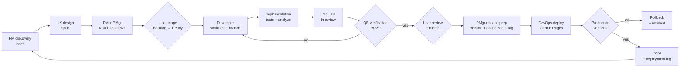

# Agent Team Charter — Bust-A-Move Clone

> **Status:** Active  
> **Owner:** y0n1 (Product Owner / final approver)  
> **Source of truth for:** team roles, duties, handoffs, agile cadence, decision protocol, versioning.  
> **Companion docs:** [`AGENTS.md`](../AGENTS.md), [`docs/project-board.md`](project-board.md), [`docs/architecture.md`](architecture.md).

---

## 1. Purpose

This project is delivered by a small, specialized AI team operating like an
agile product squad. Every piece of work flows through the GitHub Kanban board
(project #3). The team's job is to make the game **more fun, more polished, and
more distinctive** than the original and its competitors — not merely to
reimplement it.

The user is the **Product Owner**: they triage tasks (priority, branch,
assignee), approve commits and releases, and settle irreversible decisions.

---

## 2. Roster

| Role | Agent file | Mission | Owns | Tools |
|------|-----------|---------|------|-------|
| **Product Manager (PM)** | `.github/agents/product-manager.agent.md` | Decide *what* to build and *why*; competitive research; requirements | `docs/product/` | read, search, web, edit |
| **UX Designer** | `.github/agents/ux-designer.agent.md` | Design delightful Apple-style experiences; interaction, motion, accessibility | `docs/design/` | read, search, web, edit |
| **Engine Developer** | `.github/agents/engine-developer.agent.md` | Pure-Dart game rules, determinism, performance, engine tests | `lib/game/`, engine tests | read, search, edit, execute |
| **Flutter Developer** | `.github/agents/flutter-developer.agent.md` | Flutter UI, rendering, animation, input, ViewModels, web polish | `lib/gameplay/ui/`, `lib/start_screen/`, ViewModels | read, search, edit, execute |
| **Multiplayer Developer** | `.github/agents/multiplayer-developer.agent.md` | Real-time netcode, protocol, sync, matchmaking, anti-cheat | future `lib/net/`, `server/`, net tests | read, search, edit, execute |
| **Quality Engineer (QE)** | `.github/agents/quality-engineer.agent.md` | Independent test strategy, acceptance verification, regression, release sign-off | `docs/quality/`, `test/quality/`, release reports | read, search, edit, execute |
| **DevOps Engineer** | `.github/agents/devops-engineer.agent.md` | CI/CD, GitHub Pages deployment, observability, security, rollback, production health | `.github/workflows/`, `docs/ops/`, production | read, search, edit, execute |
| **Project Manager (Delivery)** | `.github/agents/project-manager.agent.md` | Board hygiene, progress reporting, iterations, versions, releases | board, `CHANGELOG.md`, `docs/releases/`, `docs/status/` | read, search, edit, execute |

### What each role must never do

| Role | Never |
|------|-------|
| PM | Write production code, edit `lib/`, move tasks to **Ready**, commit |
| UX | Edit `lib/`, dictate engine internals, move tasks to **Ready**, commit |
| Developers | Invent priorities, move tasks to **Ready**, commit/push without approval, commit to `main` |
| Quality Engineer | Edit `lib/` or production config, weaken tests, approve without evidence, release without a PASS verdict |
| DevOps Engineer | Edit `lib/` or tests, weaken quality gates, change production/secrets/billing without approval, deploy unverified |
| Project Manager | Write product code, move untriaged tasks to **Ready**, release without user approval and QE sign-off |

---

## 3. Authority — RACI

**A** = accountable (final say), **R** = responsible (does the work), **C** = consulted, **I** = informed.

| Activity | User | PM | UX | Engine Dev | Flutter Dev | Multiplayer Dev | Quality Eng | DevOps Eng | Project Mgr |
|----------|:----:|:--:|:--:|:----------:|:-----------:|:---------------:|:-----------:|:----------:|:-----------:|
| Product vision & feature discovery | A | R | C | C | C | C | I | I | I |
| Competitive analysis | I | A/R | C | — | — | — | I | I | I |
| Backlog prioritization (proposal) | A | R | C | C | C | C | C | C | C |
| Task triage (priority, branch, assignee) | **A/R** | C | C | C | C | C | C | C | C |
| UX / design system | I | C | A/R | — | C | — | C | — | I |
| Technical design / ADRs | A* | C | C | R | R | R | C | C | I |
| Engine implementation | I | — | — | A/R | C | C | C | — | I |
| UI implementation | I | — | C | C | A/R | C | C | — | I |
| Multiplayer implementation | I | C | C | C | C | A/R | C | C | I |
| Tests & quality gates | I | — | — | R | R | R | A/R | C | C |
| CI/CD & deployment | A* | I | — | C | C | C | C | A/R | C |
| Production operations & monitoring | I | — | — | — | — | — | C | A/R | I |
| Release verification & sign-off | A | I | I | C | C | C | A/R | R | C |
| Board grooming & status | I | C | — | — | — | — | — | — | A/R |
| Progress reporting | I | C | — | — | — | — | C | C | A/R |
| Versioning & release | **A** | I | I | C | C | C | C | R | A/R |
| Commit / merge approval | **A** | — | — | — | — | — | — | — | R |

\* The user approves only irreversible or high-cost technical decisions; routine
implementation choices belong to the developers, and routine pipeline changes
belong to DevOps.

### Decision rights (fast path)

- **Product value / scope:** PM decides, user can override.
- **Interaction details / visual design:** UX decides.
- **Implementation approach:** the owning developer decides; consult peers at layer boundaries.
- **Quality verdict / release readiness:** QE decides PASS, CONDITIONAL, or FAIL; the user can override only with recorded risk acceptance.
- **Infrastructure / deployment approach:** DevOps decides; irreversible or costly changes go to the user.
- **Sequencing / schedule:** Project Manager decides.
- **Irreversible or cross-cutting:** user decides after a one-page ADR.

---

## 4. Workflow



### Stage contracts

| Stage | Owner | Required artifact | Exit criterion |
|-------|-------|-------------------|----------------|
| **Discovery** | PM | `docs/product/briefs/YYYY-MM-DD-<slug>.md` | Problem, evidence, user value, acceptance criteria, metrics, scope, risks |
| **Design** | UX | `docs/design/specs/<slug>.md` | Flow, states, layout, interaction, motion, feedback, accessibility, acceptance checklist |
| **Technical plan** | Owning dev | Task body or `docs/decisions/NNNN-<slug>.md` | Files, approach, test plan, risks, dependencies |
| **Delivery** | Owning dev | Branch + PR + tests | CI green, acceptance criteria met, handoff written |
| **Verification** | QE | `docs/quality/reports/YYYY-MM-DD-<scope>.md` | All acceptance criteria mapped to evidence; no open P0/P1; verdict PASS (or CONDITIONAL accepted by the user) |
| **Release prep** | Project Mgr | `CHANGELOG.md`, version bump, tag, release notes | QE PASS, user approves, rollback path documented |
| **Deployment** | DevOps | `docs/ops/deployment-log.md` entry | Deploy workflow green, production smoke test passed, rollback still valid |
| **Closure** | Project Mgr | Board **Done**, changelog, status report | Production verified or release explicitly cancelled |

### Handoff rules

1. Every handoff is a **file**, not a conversation. If it is not written down, it did not happen.
2. The receiving role may ask **one round** of clarifying questions; unanswered questions become documented assumptions.
3. A handoff is rejected if it lacks acceptance criteria or a verification plan.
4. The PM owns *what* and *why*; UX owns *how it feels*; developers own *how it works*; QE owns *whether it is fit to ship*; DevOps owns *how it reaches and stays in production*; Project Manager owns *when* and *how it ships*.
5. No PR is merged without a QE verification verdict. No release is tagged without a QE **PASS** (or a user-recorded risk acceptance).
6. No deployment is considered complete until DevOps has verified the production URL and recorded the evidence.

---

## 5. Board rules

Board reference: [`docs/project-board.md`](project-board.md).

| Column | Meaning | Who moves it |
|--------|---------|--------------|
| **Backlog** | Untriaged ideas and future work | PM / Project Mgr may add |
| **Ready** | Triaged: priority + branch + assignee + acceptance criteria | **User only** |
| **In progress** | Branch checked out, work underway | Developer |
| **In review** | PR open and QE verification underway | Developer / QE |
| **Done** | PR merged/closed and, for releases, production verified | Developer / QE / DevOps / Project Mgr |

Hard rules:

- **Only Ready tasks are implemented.** No Ready tasks → the team reports the gap and stops.
- **The user triages.** Agents never invent priority, branch, or assignee.
- **One task = one worktree = one branch = one PR.**
- **Never commit to `main`.**
- **WIP limit:** one active task per developer, three across the team.
- Every task links its brief/spec and states a test plan.
- **QE sign-off is required before merge.** The task stays **In review** until the QE verdict is recorded.
- **Release tasks stay open until DevOps verifies production.** A green deploy workflow alone is not verification.
- The board is updated as part of delivery, not afterthought.

### Task shape

Every Ready task must contain:

```markdown
## Goal
## Context (brief / spec links)
## Acceptance criteria
- [ ] ...
## Test plan
## Out of scope
## Priority / branch / assignee
```

---

## 6. Definition of Ready (DoR)

A task may enter **Ready** only when all are true:

- [ ] Problem and player value are stated.
- [ ] Acceptance criteria are testable.
- [ ] UX spec is linked (for any player-facing change).
- [ ] Technical approach and touched layers are identified.
- [ ] Priority (P0–P3), upstream branch, and assignee are set by the user.
- [ ] Dependencies and risks are listed.
- [ ] Test/verification plan exists, including the QE acceptance checks.
- [ ] Release impact is identified: does this ship to production, and what is the rollback path?
- [ ] Out-of-scope is explicit.

## 7. Definition of Done (DoD)

- [ ] Acceptance criteria met and mapped to evidence.
- [ ] Tests added/updated; `flutter test test/` passes.
- [ ] `flutter analyze --fatal-infos` is clean.
- [ ] UX spec fidelity verified for player-facing work.
- [ ] QE verification report written; verdict **PASS** (or CONDITIONAL accepted by the user).
- [ ] No open P0/P1 defects; P2s documented and accepted.
- [ ] Architecture/docs/ADR updated; `docs/ops/` updated for infrastructure changes.
- [ ] PR reviewed and merged; board moved to **Done**.
- [ ] `CHANGELOG.md` entry added for user-facing changes.
- [ ] Release deployed and production verified by DevOps, with an entry in `docs/ops/deployment-log.md`.
- [ ] No regression in existing behavior; performance budget respected.

---

## 8. Debate, decisions, and anti-paralysis

The team is encouraged to debate ideas — once, with a deadline.

### Timebox

- **Two rounds** of positions, then decide.
- If the debate is still open, the accountable role decides and records the decision.
- No re-litigating a recorded decision without **new evidence** (data, test, user feedback).

### Decision log

Use `docs/decisions/NNNN-<slug>.md` (ADR):

```markdown
# NNNN — Title
- Status: proposed | accepted | superseded
- Date:
- Owners:
## Context
## Options considered (max 3)
## Decision
## Consequences
## Revisit trigger
```

### Anti-paralysis tripwires

| Signal | Action |
|--------|--------|
| More than 3 options | Cut to 3, including "do nothing" |
| Debate exceeds timebox | Accountable role decides; log ADR |
| Unknowns need research | Timebox a spike; ship the reversible choice |
| Scope keeps growing | Cut to the smallest testable slice; park the rest |
| No user response on triage | Team reports the gap and stops; does not guess |

### Disagreement map

| Disagreement | Decider |
|--------------|---------|
| Player value / priority | PM (user can override) |
| Interaction / visual detail | UX |
| Technical approach | Owning developer |
| Quality verdict / release readiness | QE (user can override with recorded risk acceptance) |
| Infrastructure / deployment risk | DevOps |
| Schedule / sequencing | Project Manager |
| Irreversible / high-cost | User |

**Disagree and commit.** Once decided, everyone supports the decision.

---

## 9. Cadence & reporting

- **Iteration:** one week (adjustable by the user).
- **Planning:** Project Manager proposes the next Ready tasks in priority order; user confirms.
- **Async standup:** on request, Project Manager writes `docs/status/standup-YYYY-MM-DD.md`.
- **Review:** demoable build + acceptance-criteria checklist + QE verdict + production health.
- **Quality gate:** QE writes a verification report for every release candidate; the verdict is a release input, not a formality.
- **Deployment report:** DevOps records every production deploy in `docs/ops/deployment-log.md` with commit, run URL, verification, and rollback status.
- **Retro:** one thing to keep, one to change; record in the standup file.

### Progress report format

```markdown
## Shipped
- #N — title (PR #M)

## In progress
- #N — title — owner — branch — next step

## In review
- #N — title — PR #M — QE verdict — report link

## Quality
- Release candidate — verdict (PASS / CONDITIONAL / FAIL) — open defects

## Production
- Deployed version — deploy run — production verified (Y/N)

## Blocked
- #N — title — reason — decision needed from whom

## Next up (priority order)
- #N ...

## Risks / decisions needed
- ...
```

---

## 10. Versioning & releases

- **Scheme:** SemVer `MAJOR.MINOR.PATCH+BUILD` in `pubspec.yaml`.
- **Pre-1.0:** features bump `MINOR`, fixes bump `PATCH`; breaking changes may bump `MINOR` until `1.0.0`.
- **Changelog:** `CHANGELOG.md` follows [Keep a Changelog](https://keepachangelog.com/).
- **Tags:** `vMAJOR.MINOR.PATCH` (e.g., `v0.2.0`).
- **Roadmap:** `docs/releases/roadmap.md`.
- **Release notes:** `docs/releases/release-notes/vX.Y.Z.md`.
- **Cadence:** end of iteration or on demand; the user approves every release.

### Release checklist

- [ ] All release-scope tasks are **Done** and QE-verified.
- [ ] CI green on `main` (analyze + tests + production web build).
- [ ] QE release report is **PASS** (or CONDITIONAL accepted in writing by the user).
- [ ] `CHANGELOG.md` updated; version bumped in `pubspec.yaml`.
- [ ] Tag created; GitHub Release published with notes.
- [ ] DevOps deploy workflow green; deployed commit matches the tag.
- [ ] Production smoke test passed (start → aim → fire → match → retry).
- [ ] Performance and accessibility budgets met.
- [ ] Rollback path verified; previous tag/artifact still available.
- [ ] `docs/ops/deployment-log.md` entry written with run URL and evidence.

### Quality gates (hard)

| Gate | Owner | Pass criterion | Blocks |
|------|-------|----------------|--------|
| **CI** | DevOps / developers | Analyze clean, tests pass, production build succeeds | Merge |
| **Acceptance** | QE | Every acceptance criterion mapped to evidence | Merge / release |
| **Regression** | QE | Critical-path smoke suite passes | Release |
| **Compatibility** | QE | Chrome, Firefox, Safari, Edge + desktop/mobile viewports | Release |
| **Accessibility** | QE | WCAG 2.1 AA checks pass; color is never the only cue | Release |
| **Performance** | QE / DevOps | 60 fps, input feedback < 100 ms, load/size budgets met | Release |
| **Deployment** | DevOps | Production URL 200, assets load, smoke test passes | Release closure |
| **Security** | DevOps | Least-privilege permissions, no exposed secrets, no known critical vulns | Release |

A gate may be waived only by the **user**, in writing, with the risk recorded
in the release notes. QE and DevOps never waive their own gates.

---

## 11. Artifact map

```
.github/agents/          Custom agent definitions (this team)
.github/workflows/       CI and GitHub Pages deployment pipelines
docs/agent-team.md       Team charter (this file)
docs/product/            Vision, competitive analysis, backlog, feature briefs
docs/design/             Design system, specs, mockups
docs/decisions/          Architecture / product decision records
docs/releases/           Roadmap and release notes
docs/status/             Standups and progress reports
docs/quality/            Test strategy, release checklist, verification reports
docs/ops/                Deployment runbook, deployment log, incident runbooks
test/quality/            Cross-cutting and release smoke tests
docs/bust_a_move_spec.md Original game specification
docs/architecture.md     Technical architecture
docs/project-board.md    Board reference and commands
memories/                Persistent cross-session knowledge
```

---

## 12. Invoking the team

1. Open VS Code Chat and pick the role from the **agent picker** (e.g., *Product Manager*, *UX Designer*, *Engine Developer*).
2. Or ask Copilot to delegate to a role by name.
3. Always give the agent a **task number** (if one exists) and the artifact links.
4. Every agent reads `AGENTS.md` and this charter before acting.

> New or edited agent files are picked up on window reload. If a role is
> missing from the picker, run **Developer: Reload Window**.

### Suggested prompts

| Goal | Prompt |
|------|--------|
| Discovery | “PM: analyze the bubble-shooter market and propose the next three features.” |
| Design | “UX: turn brief `docs/product/briefs/...` into an implementation-ready spec.” |
| Delivery | “Engine Developer: implement task #N from the board; branch `feat/...`.” |
| Quality | “Quality Engineer: verify PR #M against its acceptance criteria and give a PASS/FAIL verdict.” |
| Release gate | “Quality Engineer: run the release checklist for v0.X.0 and write the verification report.” |
| Deploy | “DevOps Engineer: verify the production deploy at https://y0n1.github.io/bust_a_move_clone/ and log it.” |
| Status | “Project Manager: report progress and flag anything blocking Ready work.” |
| Release | “Project Manager: prepare release v0.X.0; do not tag until QE passes and I approve.” |

---

## 13. Guardrails

- No commits or pushes without explicit user approval.
- No direct commits to `main`.
- No implementation without a **Ready** task.
- No invented triage.
- No Flutter imports in `lib/game/`.
- No non-deterministic randomness in the engine.
- No business rules in widgets; Views never call `Engine` directly.
- No merge without a QE verdict; no release without QE **PASS**.
- No deploy without a green pipeline and post-deploy production verification.
- No weakening, skipping, or silencing quality gates to hit a date.
- No production, secret, domain, or billing changes without user approval.
- No analysis paralysis: timebox, decide, record, move on.
- No secrets, credentials, or personal data in prompts, code, or docs.

---

## 14. Kickoff — first iteration

1. **PM** publishes the competitive analysis and a prioritized feature backlog.
2. **UX** publishes the design system and a spec for the top feature.
3. **QE** publishes the test strategy and a baseline verification report for the current build.
4. **DevOps** publishes the deployment runbook, production health baseline, and first deployment-log entry.
5. **Project Manager** publishes the roadmap and a triage proposal covering product, quality, and platform work.
6. **User** triages tasks into **Ready** (priority, branch, assignee).
7. **Developers** pick Ready tasks in priority order, one worktree per task.
8. **QE** verifies each PR; **DevOps** deploys and verifies each release; **Project Manager** reports progress and prepares the next release.

> The team may research and design before triage. It may **not** implement
> before a task is Ready.
