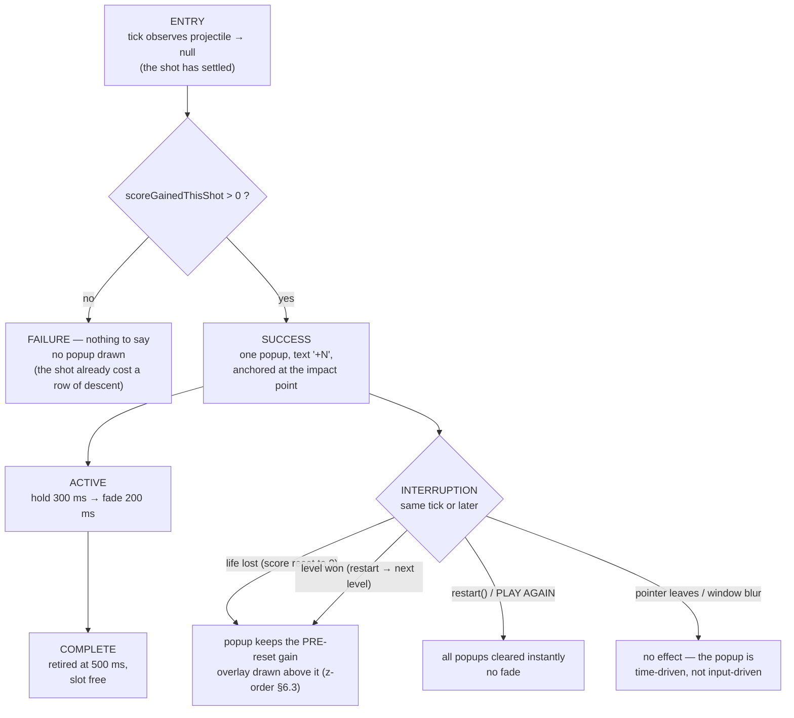

# UX Spec: Honest shot score (PB-01)

| Field | Value |
|-------|-------|
| **Status** | ready for dev (design artifact — not an implementation task) |
| **Owner** | UX Designer |
| **Task** | UX-2 / [#68](https://github.com/y0n1/bust_a_move_clone/issues/68) |
| **Product brief** | [`backlog.md`](../../product/backlog.md) PB-01 — RICE **30.0** = (5×3×1.0)/0.5, rank **1 of 12** |
| **Board state** | In progress at time of writing. UX never writes production code. |
| **Depends on** | [`design-system.md`](../design-system.md) tokens. `lib/design/tokens.dart` still does not exist — see Q5. |
| **Sibling** | [`ux-spec-bounce-aim-guide.md`](../ux-spec-bounce-aim-guide.md) (PB-03, rank 4) — same house style, different feature |

## 1. Problem

### 1.1 Provenance — which feature, and why this one

PM-3 ranked twelve opportunities by RICE in
[`backlog.md`](../../product/backlog.md) §3. The top row is **PB-01 "Honest shot score"**:

```
RICE = (Reach × Impact × Confidence) / Effort = (5 × 3 × 1.0) / 0.5 = 30.0
```

Rank 1 of 12; the next is PB-02 at 27.0. Its smallest testable slice, quoted verbatim from
the backlog:

> Score 1 200, then pop 3 (300 pts). Popup reads `+300`. Widget test asserts the string;
> one-shot demo.

**Caveat.** #66 (PM-3) is *In review*, not Done — it awaits QE validation on `main`. The
dependency this task carries is on PM-3 *identifying* the top feature, which the merged
artifact does. If QE rejects #66 and the ranking changes, this spec targets the wrong
feature and must be re-scoped.

### 1.2 What the code does today

The backlog describes a wrong number. It is worse than that: **there are two independent
defects, and fixing the number alone changes nothing a player can see.**

**D1 — the popup shows the running total, not the gain.**

```dart
// lib/gameplay/viewmodel/game_viewmodel.dart  L103
final scoreText = '+${_state.score > 0 ? _state.score : 0}';
```

`GameState.score` is the cumulative total (`lib/game/model.dart` L99). Pop 300 points when
the total is 1 200 and the popup reads **`+1500`**. Every popup in a session shows a
number that is *larger than the last*, which reads as "this shot earned 1 500".

**D2 — the popup is never drawn.** It is animated against a clock that grows quadratically.

```dart
// game_viewmodel.dart L49, L165 — `elapsed` is the Ticker's CUMULATIVE duration,
// so summing it every tick is a sum of a series, not a clock.
int _fxElapsedMs = 0;
_fxElapsedMs += elapsed.inMilliseconds;

// bubble_renderer.dart L138, L259 — the painter converts that sum back to a Duration
// and subtracts a LINEAR createdAt (set from the Ticker at creation, L106).
final elapsed = Duration(milliseconds: fxElapsedMs);
final age = (elapsed - popup.createdAt).inMilliseconds;
if (age > 500) continue;
```

Measured accumulation at 60 Hz (16.7 ms ticks):

| Tick | Wall time | `fxElapsedMs` |
|------|-----------|---------------|
| 10 | 167 ms | **918 ms** |
| 60 | 1 002 ms | **30 561 ms** |
| 600 | 10 020 ms | **3 011 010 ms** |

A popup created at tick *k* is visible only while `fx(n) − 16.7k ≤ 500`. Solving: a popup
created at tick 0 survives 7 ticks; at tick 4, 3 ticks; **at tick 8 or later it is never
drawn at all.** The shortest possible shot is ~20 ticks of flight, so *no popup has ever
rendered in normal play.* The ViewModel still retires them on the linear clock
(`L167`), so the list is correct and the paint is not — a silent mismatch.

**D3 — the particle bursts share the defect.** Same `elapsed`, same `continue` guard
(`bubble_renderer.dart` L241–L243, `age > 400`). Bursts are invisible for the same reason.
`shakeElapsedMs` and `recoilElapsedMs` are incremented by a literal `+16` per tick and
therefore work; `bigPopElapsedMs` is computed in the ViewModel on the linear clock and
works. **Two of the five juice effects are dead and nobody noticed, because the number they
would have shown was wrong anyway.**

**What the player sees today:** nothing at the impact point. The HUD total jumps
(`SCORE 1200` → `SCORE 1500`). The `COMBO ×n` chip appears for `combo ≥ 2`
(`score_display.dart` L29). That is the entire feedback for the core scoring action.

### 1.3 Why this is worth a spec

The change is small (one string, one clock, one field), but three decisions in it are not
obvious and each is expensive to get wrong later:

1. **What "this shot earned" means** when one shot pops a group, triggers a chain, and
   drops a detached cluster — one number or several, and which ones.
2. **What happens on the tick that resets the score.** Losing a life calls `startLevel`,
   which sets `score: 0` (`engine.dart` L205, L418). A ViewModel that diffs the total
   before and after that tick shows a **negative** number.
3. **How the number stays legible over the board.** It is painted on top of bubbles in six
   saturated colours; amber text on a yellow bubble is 1:1.

## 2. Flow



Four labelled paths: **ENTRY** (settle), **SUCCESS** (a scoring shot), **FAILURE** (a shot
that scored nothing), **INTERRUPTION** (reset, restart, and the non-events). Each terminates.

## 3. State inventory

The task asks for *empty, loading, active, error, complete*. Two of those do not exist for a
popup; inventing them would be worse than saying so. All five are enumerated, and the two
that cannot occur name the real state they collapse into.

| State | Occurs? | Player sees | Retained |
|-------|---------|-------------|----------|
| **Empty** | Yes — every frame with no live popup | Nothing | — |
| **Loading** | **No.** A popup is created and painted in the same frame; there is nothing to load, fetch or await. Collapses into **Empty** during `projectile != null` (the shot is in flight) | Board, projectile, trail | — |
| **Active** | Yes — 500 ms from settle | `+N`, rising 30 dp, full opacity for 300 ms then fading | Text, anchor, creation time |
| **Error** | **No rendering state.** The two error-ish *inputs* are handled as data: a zero-gain shot is **Empty**; a reset tick is **Active** with the pre-reset gain (§4.4). There is no error UI, no retry, no message | — | — |
| **Complete** | Yes — at 500 ms | Nothing; slot free for the next shot | — |

**Level-complete note.** The winning shot produces a popup in the same frame the win overlay
appears. The overlay is above popups in the z-order (design-system §5.4), so the popup is
covered immediately. That is correct and needs no special case: the overlay's stat line
carries the total, and the popup is a per-shot affordance. Do not suppress the popup — the
same code path must not branch on `status`.

## 4. The number

### 4.1 Definition

> **Shot gain** = every point the engine added to `score` while resolving this one shot,
> summed: the match-group pop (with its combo multiplier) **plus** the detached-cluster
> drop.

```
gain = _popScore(group.length) × combo  +  _dropScore(fallen)
```

Both terms are already computed in `_settleShotAt` (`engine.dart` L382–L396) and
immediately collapsed into the total. `_popScore(3) = 300`, `_popScore(4) = 450`,
`_dropScore(n) = 50n`.

**One popup per shot, aggregating the whole resolution.** Not one per popped bubble, and not
one per chain link. The player made one decision — where to aim — and the popup answers the
only question that decision raises: *what did that shot earn?* Splitting it would produce up
to six overlapping numbers for a single shot, none of which the player can attribute.

The existing per-shot aggregates already encode this shape: `poppedThisShot` and `combo` are
per-shot fields, and the `COMBO ×n` chip is a per-shot readout. The popup is the third.

### 4.2 Format

| Rule | Value | Why |
|------|-------|-----|
| Prefix | `+`, always | It is a gain, not a state |
| Digits | `int.toString()`, **no grouping separator** | Matches the HUD, which renders `'SCORE ${state.score}'` ungrouped (`score_display.dart` L23). If the HUD adopts design-system §5.1's `1 240` grouping, both change together — the popup must never disagree with the HUD |
| Space | none | `+300`, not `+ 300` |
| Sign | never `-`, never `0` | A non-scoring shot draws no popup at all (§4.3) |
| Examples | `+300` · `+450` · `+550` · `+600` | 3-pop ×1 · 4-pop ×1 · 3-pop plus a 5-bubble drop · 3-pop at combo ×2 |

### 4.3 The zero case

**A shot that scores nothing draws nothing.** Not `+0`, not a greyed `+0`, not a shake of
the head. The shot already cost a row of descent; the popup exists to reward, and a
zero-reward popup is a second punishment for the same mistake. It also keeps the screen
quiet during the exploratory play that bad boards force.

### 4.4 The reset case — the one that needs an engine change

`startLevel` sets `score: 0` (`engine.dart` L205). It is called from two places that can
land on the **same tick** as a scoring settle:

| Path | Where | Score after the tick |
|------|-------|----------------------|
| Life lost, lives remain | `engine.dart` L413–L418 — inside `tick`, same tick as the pop | **0** |
| Level won → `restart()` | `game_viewmodel.dart` L229–L230 | **0** (on the player's tap, a later frame) |

The winning shot is safe: the settle tick still carries the pre-reset total, so a diff works.
**The life-lost tick is not**: the pop is scored and the score is zeroed inside the same
`tick` call, so `state.score − prev.score` is **−300** for a shot that earned +300. A
ViewModel cannot recover the true gain from the state it receives.

**Therefore the gain must be produced by the engine**, not inferred by the UI. This is
additive and mirrors the field that already exists for pops:

```dart
// lib/game/model.dart — one new field, same lifecycle as poppedThisShot.
final int scoreGainedThisShot;   // 0 when nothing scored; cleared by startLevel
```

`startLevel` must accept and carry it on the life-loss path (`engine.dart` L418) so the popup
for the killing shot still reports what it earned. **Q1 asks for approval of this addition;
it is the only engine change PB-01 requires, and it changes no rule, constant or outcome.**

### 4.5 Data model

```dart
// lib/game/model.dart — additive field + copyWith parameter, default 0.
final int scoreGainedThisShot;

// lib/game/engine.dart — set in _settleShotAt alongside `popped`; no rule changes.
//   non-scoring settle → 0
//   scoring settle     → _popScore(len) * combo + _dropScore(fallen)
//   life-lost settle   → carried into the startLevel state (L418)

// lib/gameplay/viewmodel/game_viewmodel.dart
//   L103: replace the running total with the gain.
final scoreText = '+${_state.scoreGainedThisShot}';
//   guard: only when settled && scoreGainedThisShot > 0 (replaces poppedThisShot > 0)

// lib/gameplay/ui/renderer/bubble_renderer.dart
//   ScorePopup gains nothing. It already carries text/x/y/createdAt.
//   The age math is extracted so it has a mechanical oracle (AC-10, AC-11):
/// null when the popup has expired, else 0.0..1.0 through its lifetime.
double? popupProgress(int clockMs, int createdAtMs);   // top-level, pure
//   opacity(p) = 1.0 for p <= 0.6, else (1 - p) / 0.4   // hold 300 ms, fade 200 ms
//   rise(p)    = 30 * p                                 // dp, linear

// lib/gameplay/viewmodel/game_viewmodel.dart — the clock fix (D2).
//   Keep one linear session clock; the painter and the VM must agree on it.
int _fxElapsedMs = 0;          // linear: total elapsed since the ticker started
_onTick(Duration elapsed) {
  _fxElapsedMs = elapsed.inMilliseconds;   // NOT `+=`; `elapsed` is already cumulative
  ...
}
```

**The clock fix is one line and it revives the particle bursts (D3) as a side effect.** That
is a visible change beyond PB-01's headline — currently the player sees no particles at all.
It is an improvement, but it must be a deliberate, announced consequence rather than a
smuggled one: **Q2 asks whether to take it here or split it.**

## 5. Interaction detail

### 5.1 Input

**None.** The popup adds no control, no gesture, no key and no tap target. It is emitted by
the settle it describes. This is deliberate: the scoring moment must not compete with aiming
for the pointer, and a popup that can be dismissed is a popup the player can miss.

The only input interaction is indirect: `restart()` (the overlay button) clears all popups
instantly, so a new level never opens under a stale number.

### 5.2 Feedback

| The player did | Immediate feedback (same frame) | Popup |
|----------------|--------------------------------|-------|
| Popped 3 | Bubbles vanish, burst, cannon recoil | `+300` at the impact point |
| Popped 4+ | Above, plus screen shake (200 ms) and `BIG POP!` if ≥ 5 | `+450`+ |
| Chained a second pop | Chain links pop with a 60 ms stagger | **one** popup, the summed gain |
| Dropped a detached cluster | Cluster falls | included in the same popup |
| Popped nothing | Bubble attaches, wall descends | **none** |
| Cleared the board | Win overlay | popup drawn, then covered by the scrim |
| Lost a life | Board resets, lives −1 | popup reports the gain, keeps rising over the reset board |

### 5.3 Timing

| Moment | t = 0 | Source |
|--------|-------|--------|
| Popup created | the tick where `projectile` becomes null | `_onTick` `settled` branch |
| Full opacity | 0 → 300 ms | design-system §4 row 11 ("fade in last 40%") |
| Fade begins | 300 ms | 500 × 0.6 |
| Retired | 500 ms | design-system §4 row 11 |
| Rise | 30 dp over the full 500 ms, linear | design-system §4 row 11; today's `rise = 30 * progress` |

The popup **holds** at full opacity for 300 ms. Today's code fades linearly from frame one,
which makes the number legible for about 150 ms — not enough to read a four-digit value
while tracking a moving projectile. The design system already specifies the hold; the
implementation does not do it.

### 5.4 Edge cases

1. **Score is already large.** At a running total of 1 200, a 3-pop still reads `+300`. The
   total never appears in a popup — that is the whole defect PB-01 fixes.
2. **Combo ≥ 2.** The gain already includes the multiplier (`_popScore × combo`). The popup
   shows the multiplied total, **not** `+300 ×3` — the `COMBO ×3` chip beside the HUD score
   already states the multiplier, and repeating it in the popup would show the same fact
   twice in two formats.
3. **Pop and drop in one shot.** A 4-pop (`_popScore(4) = 450`) plus a 5-bubble drop
   (`_dropScore(5) = 250`) → **`+700`**. One popup, both terms.
4. **The killing shot.** The shot pops 300, the wall descends past the cannon line, the board
   resets. The popup still reads `+300` (never `−300`, never `+0`). §4.4.
5. **The winning shot.** Popup `+N` is drawn and immediately covered by the win overlay. No
   suppression, no delay, no special case.
6. **Impact at the top row.** The anchor is near `y = 0` and the popup rises 30 dp off the
   canvas. The drawn baseline is clamped to ≥ 4 dp below the playfield's top edge; the rise
   is *shortened*, never inverted.
7. **Impact at a side wall.** The anchor is at `x = 0` or `x = cols`; half the text would
   overhang. The text rect is clamped to the playfield's horizontal bounds (which, in
   portrait, are the canvas bounds — `computeLayout` sets `offsetX = 0`).
8. **Two shots inside 500 ms.** Impossible to *aim* twice in 500 ms, but a queued second
   settle is reachable if the first shot's flight overlaps a fast second fire. The popup is a
   **single slot**: creating a popup retires any live one immediately. The player never sees
   two numbers and never has to work out which is which.
9. **`restart()` during a live popup.** All popups cleared, no fade. The new level starts
   clean.
10. **Reduced motion on.** The rise is dropped; the number still appears for 500 ms. §7.4.

## 6. Layout

### 6.1 Anchor

The anchor is the **impact point** — the projectile's position on the tick it settled
(`prev.projectile!.x/y`, board-space), which is where the player's shot landed and therefore
where the eye already is. It is **not** the centroid of the popped group: the group can
extend several rows away, and a number floating over an untouched part of the board reads as
belonging to those bubbles.

Conversion is the existing one: `boardToScreen(x, y − rise / bubbleSize)`.

### 6.2 Clamp

| Axis | Rule |
|------|------|
| Horizontal | Text rect centre clamped so the rect stays within `[offsetX, offsetX + cols × bubbleSize]`; in portrait that is the canvas, so the clamp is `[halfWidth, size.width − halfWidth]` |
| Vertical | Drawn centre clamped to ≥ `4 dp` below `offsetY`; the rise is shortened (never negative) to satisfy it |
| Both | The clamp moves the *drawn* rect only; the stored anchor is unchanged, so the number does not drift across frames as it rises |

### 6.3 Z-order

Popups sit between particles and the `BIG POP!` banner, exactly as design-system §5.4 fixes
it: `… → particles → **score popups** → BIG POP! → HUD bar → scrim → overlay card`. The board
occludes nothing; the banner and the overlay both occlude the popup, which is correct — they
are louder and rarer.

### 6.4 Responsive breakpoints

The popup is geometry plus one text run; it inherits the board's scaling and needs no
breakpoint of its own. It is defined in terms that already respond (design-system §5.3):

| Breakpoint | Width | `bubbleSize` | Popup consequence |
|------------|-------|--------------|-------------------|
| Compact | 360–599 | clamped 32–120 | Text is a fixed 20 dp (`titleMd`) and does **not** scale with `bubbleSize`; only the rise and the anchor do |
| Medium | 600–1023 | clamped | Same; more board, same number |
| Wide | ≥ 1024 | board letterboxed to 1024 | Clamp uses the **board's** bounds, not the window's — otherwise the popup floats in the letterbox |
| Short | height < 520 | remaining height | Vertical clamp keeps the number on screen when the anchor is near the top |

**Fixed 20 dp is deliberate.** Scaling the popup with the board would make it huge on a wide
desktop board (120 dp × 20/48 ≈ 50 dp) and unreadable on a small phone. The number's job is
to be read, so it is sized for reading.

### 6.5 Safe area

The playfield is laid out inside `SafeArea(bottom: false)` (design-system §5.1), and the
popup is painted inside the `CustomPaint`, so notch/home-indicator insets are already
excluded by the layout. **No extra inset is applied** — but the §6.2 clamps are relative to
the *paint* bounds, so a safe-area change can never push the number under a notch.

## 7. Motion & juice

### 7.1 Spec

| Property | Value | Token |
|----------|-------|-------|
| Lifetime | 500 ms | design-system §4 row 11 |
| Rise | 30 dp, linear, over the full 500 ms | row 11 |
| Opacity | 1.0 for 0–300 ms; 300→500 ms linear 1.0 → 0.0 | row 11 ("fade in last 40%") |
| Easing on the fade | `AppMotion.exit` — `Cubic(0.4, 0.0, 1.0, 1.0)` | §3.7 |
| Scale | **none** | Restraint; the number is information, not a prize |
| Rotation / wobble | **none** | — |
| Loop | **none** — a popup never loops, pulses or bobs while idle | design-system principle 4 |
| Blur / shadow | **none** on the text | A `MaskFilter` on text is a per-frame cost for no legibility gain; the stroke (§7.2) does the job |

### 7.2 Legibility over the board

The popup is painted on top of bubbles in six saturated fills. `AppColors.accent`
(`0xFFFDD835`) over a yellow bubble (`0xFFFDD835`) is **1:1** — invisible. Therefore the
number is drawn **twice**, in the standard floating-combat-text idiom:

1. `TextStyle(foreground: Paint()..style = PaintingStyle.stroke..strokeWidth = 1.5
   ..color = AppColors.surfaceBase)` — a 1.5 dp halo in `#0B1E3A`
2. `TextStyle(color: AppColors.accent)` — the fill, on top

The halo guarantees separation from *any* fill behind it, and it costs one extra
`TextPainter.paint` on a ≤ 6-character run.

**Colour change.** Today's fill is the untokened literal `0xFFFFD54F`. Replace it with
`AppColors.accent` `0xFFFDD835` — measured 11.93:1 on `surfaceBase` versus today's 11.80:1,
so the change is imperceptible and the value becomes a token.

### 7.3 Typography

`AppType.titleMd` — 20 dp, `w700`, letter-spacing 0.5, height 1.2. This is what the code
already uses (`fontSize: 20`, `FontWeight.bold`), so the change is nominal: name the token.
No tabular figures — the string is static for its lifetime, so nothing jitters.

### 7.4 Reduced motion

`MediaQuery.maybeDisableAnimationsOf(context) ?? false` (design-system §3.7 gate):

| Property | Normal | Reduced |
|----------|--------|---------|
| Rise | 30 dp | **0** — drawn at the anchor |
| Opacity | hold 300, fade 200 | **identical** |
| Lifetime | 500 ms | **identical** |

**This deviates from design-system §4 row 11**, whose fallback is "`base` 220 ms fade in
place". The deviation is deliberate: 220 ms is not enough time to read `+1250`, and reduced
motion means *less movement*, not *less information*. The popup is the only place the gain
appears, so suppressing its duration suppresses the content. **Q3 asks for approval**; if
the design system is authoritative, take 220 ms and accept the readability loss.

### 7.5 Interaction with the other juice

| Effect | Same trigger | Relationship |
|--------|--------------|--------------|
| Particle burst | yes, ≥ 1 pop | 400 ms, behind the popup in z-order. Once D2 is fixed, both appear for the first time; the burst is 8 particles at 0.15 × `bubbleSize`, well under the text |
| Screen shake | `poppedThisShot ≥ 4` | 200 ms, ±2 dp. **The popup is inside the shaken transform** (it is painted in the same canvas), so it shakes with the board. Correct — it belongs to the impact |
| `BIG POP!` banner | `poppedThisShot ≥ 5` | Above the popup, 320 + 400 + 500 ms. Both are visible; the banner is the headline, the popup is the detail |
| Cannon recoil | `poppedThisShot ≥ 1` | 100 ms, unrelated position |

## 8. Accessibility

### 8.1 Contrast (SC 1.4.3 / 1.4.11)

Measured against `surfaceBase #0B1E3A` (relative luminance 0.0130):

| Item | Ratio | Verdict |
|------|-------|---------|
| `AppColors.accent` #FDD835 on `surfaceBase` | **11.93:1** | ✅ AAA for text |
| Today's literal #FFD54F | 11.80:1 | ✅ but untokened |
| Accent fill against the halo `surfaceBase` | 11.93:1 | ✅ the halo *is* the effective background |
| Accent over the worst bubble (yellow #FDD835), no halo | **1.00:1** | ❌ — this is why §7.2 exists |

### 8.2 Colour is never the only cue (SC 1.4.1)

The popup carries no hue-coded meaning: a `+` and digits. Its shape does not depend on
bubble colour, and it is identical in every CVD type. It is *not* a substitute for the
bubble shape cues (design-system §6.2) and never needs one.

### 8.3 Screen reader

Painted text has no semantics. The gain must therefore be exposed as widget semantics, and
the number is worth announcing: it is the only place the per-shot gain exists.

- `GameScreen` gains one `Semantics` node over the playfield:
  `label: 'Plus ${gain} points'`, `liveRegion: true`, present only while a popup is live.
- **No existing live region competes.** `game_screen.dart` contains no `Semantics` today,
  and `ScoreDisplay` is plain `Text`, so there is exactly one announcement per scoring shot.
  When the HUD score later becomes a live region (design-system §6.4 proposes it), the
  announcement must move to the *gain* and the total must not also announce — otherwise
  every shot speaks twice. **Q4 records this.**
- The node is `ExcludeSemantics`-safe: it never blocks the board's summary label.

### 8.4 Reduced motion, text scale, targets

| Requirement | Handling |
|-------------|----------|
| Reduced motion | §7.4 — movement dropped, duration kept |
| Text scaling | The popup is painted, not laid out by Flutter, so `textScaler` does not reach it. **Clamp the painted size to `min(20 × textScale, 26)`** and re-measure the clamp in §6.2 against the scaled rect |
| Touch targets | None — the popup is not interactive (SC 2.5.5 does not apply) |
| Timing | No time limit on any response the popup gates — it gates nothing (SC 2.2.1 does not apply) |

### 8.5 What this spec deliberately does not claim

The popup does not make the game playable without sight. It makes the *number* honest and
announced. Board readability, keyboard aim and the death-line warning are separate tasks
(design-system §6.4, PB-03).

## 9. Acceptance checklist

Every row is one assertion with one exact expected value and a named test file. QE can
transcribe this table into a verification report without design judgement.

`test/gameplay/ui/renderer/` and `test/gameplay/ui/` exist and are empty; rows marked
*(new file)* create them.

| # | Assertion | Test file | Exact expectation |
|---|-----------|-----------|-------------------|
| **AC-1** | A scoring settle reports the points it added | `test/engine_test.dart` | 3-bubble pop at combo ×1 → `scoreGainedThisShot == 300` **and** `score − previousScore == 300` |
| **AC-2** | A non-scoring settle reports 0 | `test/engine_test.dart` | shot that pops nothing → `scoreGainedThisShot == 0`, `poppedThisShot == 0` |
| **AC-3** | The gain survives a same-tick score reset | `test/engine_test.dart` | life-lost settle that also popped 3 → `score == 0` **and** `scoreGainedThisShot == 300` |
| **AC-4** | Pop and drop are summed into one gain | `test/engine_test.dart` | 3-pop + 5-bubble drop → `scoreGainedThisShot == 550` |
| **AC-5** | The popup text is the gain, not the total | `test/gameplay/viewmodel/game_viewmodel_test.dart` | state at `score == 1200` then a 300-point pop → `popups.single.text == '+300'` (today: `'+1500'`) |
| **AC-6** | A zero-gain shot draws no popup | `test/gameplay/viewmodel/game_viewmodel_test.dart` | `popups.isEmpty` |
| **AC-7** | The popup is a single slot | `test/gameplay/viewmodel/game_viewmodel_test.dart` | two scoring settles 200 ms apart → `popups.length == 1`, text is the **newer** gain |
| **AC-8** | Retirement at 500 ms on the linear clock | `test/gameplay/viewmodel/game_viewmodel_test.dart` | present at `createdAt + 499 ms`, `popups.isEmpty` at `+500 ms` |
| **AC-9** | The FX clock is linear (regression for D2) | `test/gameplay/ui/renderer/bubble_renderer_test.dart` *(new file)* | 60 ticks of 16.7 ms → `fxElapsedMs` in `[1000, 1004]` (today: `30 561`) |
| **AC-10** | A popup created late is still drawn | `test/gameplay/ui/renderer/bubble_renderer_test.dart` | `popupProgress(clockMs: 1202, createdAtMs: 1002)` is non-null and in `(0, 1)` (today: `null`) |
| **AC-11** | Hold then fade | `test/gameplay/ui/renderer/bubble_renderer_test.dart` | alpha `1.0` at 0 ms and at 300 ms; `0.0` at 500 ms; monotonically non-increasing on `[300, 500]` |
| **AC-12** | The painter receives the ViewModel's popup | `test/gameplay/ui/game_screen_score_popup_test.dart` *(new file)* | after a scoring settle, `painter.popups.single.text == vm.popups.single.text` |
| **AC-13** | Every popup string is `+` followed by digits | `test/gameplay/ui/game_screen_score_popup_test.dart` | 20-shot scripted run → 0 strings failing `RegExp(r'^\+\d+$')`, 0 containing `-` or `+0` |
| **AC-14** | Reduced motion keeps the information | `test/gameplay/ui/game_screen_score_popup_test.dart` | `disableAnimations: true` → rise offset `0` on every frame, lifetime still 500 ms |
| **AC-15** | No regressions | whole suite | `flutter test test/` green (48 existing + new); `flutter analyze --fatal-infos` clean |

**Not in the checklist, by design:** the 1.5 dp halo (§7.2) and the anchor clamp (§6.2) are
*visual* properties with no mechanical oracle. QE confirms both from a production screenshot
at the release gate — one number over a yellow bubble must be readable, and one number
anchored at a wall must not clip. Everything else is automated.

## 10. Open questions

| # | Question | Needed from | Recommendation |
|---|----------|-------------|----------------|
| **Q1** | Approve one **additive** `GameState.scoreGainedThisShot`, set in `_settleShotAt` and carried through the life-loss `startLevel` call. No rule, constant or outcome changes; it mirrors `poppedThisShot`. Without it, the killing shot reports `−300`. | Product Owner + Engine Developer | **Approve.** The alternative — diffing the total in the ViewModel — is wrong on exactly the tick that matters most |
| **Q2** | Take the one-line linear-clock fix here, or split it? Fixing it revives **particle bursts**, which have never been visible (D3) — a real visual change beyond PB-01's headline. | Product Owner | **Take it here.** Shipping an honest number that is still invisible is not a fix; and a second task to make the first task's output appear is worse than one task that does both |
| **Q3** | Reduced-motion duration: 500 ms hold+fade (this spec) or the design system's 220 ms fade-in-place? | Product Owner + design-system owner | **500 ms.** Reduced motion is less movement, not less information |
| **Q4** | Who owns the score live region? Today there is none. This spec adds one for the gain. When design-system §6.4's HUD live region lands, exactly one of the two must speak. | Flutter Developer + PM | Gain speaks; total does not. Recorded in the HUD task, not here |
| **Q5** | `lib/design/tokens.dart` still does not exist. Inline `0xFFFDD835` with a TODO, or land the token file first? (design-system Q1; `lib/design/` is unassigned) | Product Owner | Inline with a TODO — PB-01 is 0.5 dev-weeks and must not be gated on a file-ownership decision |
| **Q6** | Should the popup show the combo multiplier (`+900 ×3`) when `combo ≥ 2`? | Product Owner | **No.** The `COMBO ×3` chip already states it; two formats for one fact is noise |

## 11. Out of scope

1. **Any engine rule change** — no scoring formula, combo, descent, collision or level-tuning change. Q1's field is additive state, not a rule.
2. **The Flutter implementation.** This is a design artifact; PB-01 needs its own board task (Flutter Developer for the UI/ViewModel, Engine Developer for Q1's field).
3. **Particle bursts, screen shake, `BIG POP!`** — their timings are untouched. Q2's clock fix changes whether bursts *appear*, not what they look like.
4. **The HUD score's formatting or semantics** — grouping, tabular figures and its live region are design-system §5.1/§6.4 work (Q4 records the boundary).
5. **Floating text for anything else** — lives lost, combo breaks, level clear. One number, one meaning.
6. **Score survives a life loss** — that is **PB-05** (rank 3, RICE 19.2). PB-01 makes the *gain* honest while the total still resets; PB-05 makes the *total* survive. They are independent and must not be merged: PB-01's AC-3 depends on the reset happening.
7. **Sound, haptics, a popup toggle, pause** (PB-07, PB-10, design-system Q3/Q5).

> **Engine-change callout.** PB-01 needs exactly one additive field on `GameState`. It is not
> a rule change: no constant, branch, formula or output moves, and every existing test keeps
> its expected values. If the constraint is "do not touch `lib/game/` at all", PB-01 degrades
> to a correct number for every shot except the one that loses a life — I recommend against
> shipping that, because the losing shot is when the player most needs to know what the shot
> was worth.
