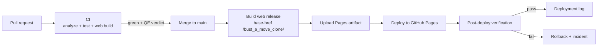

# Deployment Runbook — Bust-A-Move Clone

> **Owner:** DevOps Engineer  
> **Production:** <https://y0n1.github.io/bust_a_move_clone/>  
> **Last verified:** 2026-10-23 (v1.0.0+1, commit `4b5d3fe`)  
> **Companions:** [`deployment-log.md`](deployment-log.md), [`../agent-team.md`](../agent-team.md), [`.github/workflows/`](../../.github/workflows/)

---

## 1. Production contract

| Item | Value |
|------|-------|
| Hosting | GitHub Pages, deployed through GitHub Actions |
| URL | `https://y0n1.github.io/bust_a_move_clone/` |
| Repository | `y0n1/bust_a_move_clone` |
| Source branch | `main` |
| Deploy workflow | `.github/workflows/deploy-pages.yml` |
| CI workflow | `.github/workflows/ci.yml` |
| Build command | `flutter build web --release --base-href /bust_a_move_clone/` |
| Build artifact | `build/web` |
| Artifact upload | `actions/upload-pages-artifact@v3` |
| Deploy action | `actions/deploy-pages@v4` |
| Token permissions | `contents: read`, `pages: write`, `id-token: write` |
| Concurrency | group `pages`, `cancel-in-progress: false` |
| Toolchain baseline | Flutter 3.47.1 stable, Dart 3.13.1 |

The base href **must** match the Pages sub-path. A mismatch produces a blank
page because every asset request resolves to the wrong URL.

---

## 2. Environments

| Environment | How it is produced | Purpose |
|-------------|--------------------|---------|
| **Local dev** | `flutter run -d chrome` | Fast iteration; not a release artifact |
| **Local production build** | `flutter build web --release --base-href /bust_a_move_clone/` | Reproduce the exact Pages artifact |
| **CI** | GitHub Actions on pull requests and pushes to `develop` | Analyze, test, and web build gate |
| **Production** | GitHub Actions on push to `main` | Player-facing build |

There is currently **no PR preview environment**. A PR is verified through CI,
tests, and a locally served production build.

---

## 3. Pipeline



### CI (pull requests)

Two jobs, run in parallel:

**`analyze-test`**

1. Checkout.
2. Install Flutter — **pinned** to the version in the **Toolchain baseline** row
   of §1, via `subosito/flutter-action@v2` (`flutter-version`, `cache: true`).
3. `flutter pub get`.
4. `flutter analyze --fatal-infos`.
5. `flutter test test/`.

**`build-web`**

1. Checkout.
2. Install Flutter — the same pinned version, read from the `FLUTTER_VERSION`
   env var that both jobs share.
3. `flutter pub get`.
4. `flutter build web --release --base-href /bust_a_move_clone/`.
5. Report sizes to the job summary: `build/web` and `main.dart.js` on disk, plus
   `main.dart.js` gzipped — the gzip figure is the one EQ-5 in
   [`docs/product/vision.md`](../product/vision.md) budgets against.

The build command is byte-identical to the one in the deploy workflow below. If
those two drift, `build-web` stops proving the production build — a base-href
typo or a web-only compile error would pass PR CI and fail on `main` instead.
Keep them in step.

The jobs are separate rather than sequential on purpose: a web compile error is
independent of whether the tests pass, so running them in parallel costs the
build's wall-clock once instead of adding it to every PR.

### Deploy (push to `main`)

1. Checkout the merged commit.
2. Install Flutter — the **same pinned version** as CI.
3. `flutter pub get`.
4. `flutter build web --release --base-href /bust_a_move_clone/`.
5. Upload `build/web` as the Pages artifact.
6. Deploy with `actions/deploy-pages@v4`.

Only one deployment runs at a time. In-flight production deploys are never
cancelled.

---

## 4. Reproducing a production build locally

```bash
flutter pub get
flutter build web --release --base-href /bust_a_move_clone/
rm -rf /tmp/bam-preview && mkdir -p /tmp/bam-preview
cp -r build/web /tmp/bam-preview/bust_a_move_clone
python3 -m http.server 8400 --directory /tmp/bam-preview
# Open http://localhost:8400/bust_a_move_clone/
```

The artifact must be served **under** a `bust_a_move_clone/` directory so the
base href resolves. Serving `build/web` directly at the server root produces a
blank page and 404s for every asset.

---

## 5. Bumping the toolchain

The Flutter version is **pinned, not floating**. A channel (`stable`) resolves
whatever is current at run time, so the toolchain could change between two runs
of the same commit. The pin makes a green build mean the same thing tomorrow as
it did today.

The version appears in **four** files that must agree. `ci.yml` defines it once,
in a workflow-level `env:` block that both of its jobs read, so the two jobs
cannot drift onto different toolchains. Change all four in one commit:

| File | What to change |
|------|----------------|
| `.github/workflows/ci.yml` | `FLUTTER_VERSION` in the workflow-level `env:` block |
| `.github/workflows/deploy-pages.yml` | `flutter-version: '<version>'` |
| `docs/ops/deployment.md` | The **Toolchain baseline** row in §1, **and** the illustrative `checkout`/`fvm use` commands in step 3 below |
| `README.md` | The version in the prerequisites block (prose only) |

### Procedure

1. Confirm the target version exists on the stable channel in the
   [Flutter release notes](https://docs.flutter.dev/release/release-notes).
   `flutter --version` reports what is installed *locally*, which is not
   evidence that a different version is available.
2. Update the version in both workflow files, the baseline row, and the
   `README.md` prerequisites.
3. Switch your **local** SDK to the target version, then run the full gate on it.
   Neither `flutter upgrade` nor `flutter downgrade` can target a version —
   `upgrade` moves to newest stable, and `downgrade` only undoes the last
   `upgrade`. Use the
   [documented switch](https://docs.flutter.dev/install/upgrade#switch-to-a-specific-flutter-version)
   — check out the tag in the SDK clone — or a version manager:

   ```bash
   # Option A: check out the tag in your Flutter SDK clone.
   # `git -C` keeps you in the project directory — the gate below must run
   # against the app, not against the Flutter framework.
   # (`readlink -f` is GNU; on macOS use Option B or resolve the path by hand.)
   SDK="$(dirname "$(dirname "$(readlink -f "$(which flutter)")")")"
   git -C "$SDK" fetch --tags && git -C "$SDK" checkout 3.47.1

   # Option B: a version manager (FVM), then use `fvm flutter` for every step
   fvm use 3.47.1

   # Then run the gate from the project root — `fvm flutter` under Option B
   flutter --version                       # confirm the switch took effect
   flutter pub get
   flutter analyze --fatal-infos
   flutter test test/
   flutter build web --release --base-href /bust_a_move_clone/
   ```

   Option B only changes what `fvm flutter` resolves to. Bare `flutter` still
   runs the SDK on your `PATH`, so either use `fvm flutter` throughout or make
   sure the FVM SDK is the one on `PATH` — otherwise you are gating a different
   toolchain than CI, which is the whole thing this section exists to prevent.

4. Commit as `ci(deps): bump Flutter to <version>` — a `ci`/`deps` scope, so it
   does not bump the release version on its own.
5. Let CI run. A green `analyze-test` **and** `build-web` proves the pin for the
   gate. Both jobs read the same `FLUTTER_VERSION`, so they cannot drift onto
   different toolchains; the deploy workflow only fires on a push to `main`, so
   the production half of the proof lands at the next release, not on the bump
   PR. Two CI runs are needed to demonstrate cache reuse: the first populates
   the cache for the new version, the second hits it.
6. If the deploy fails, revert the four files together — never leave CI, the
   deploy workflow, the runbook, and the README disagreeing about the toolchain.

### Rules

- **Both workflows move together.** CI and production must build with the same
  toolchain, or a green PR can still break the deploy.
- **`flutter-version` is the pin; `channel:` is not.** `channel` defaults to
  `stable` and filters the release list *before* the version is resolved, so a
  pinned version must exist on the channel you name — `channel: beta` beside
  `flutter-version: '3.47.1'` fails with `Unable to determine Flutter version`.
  Leave `channel` out; the default `stable` is what the pin resolves against.
  Removing `flutter-version` resolves the newest release on the channel, and
  that is a floating toolchain. Never name a mismatched channel, and never drop
  the pin.
- **Never pin a version that has not passed the full gate.** The pin is a
  contract, not a suggestion.
- Keep `cache: true`. The cache key includes the pinned version, so a bump
  invalidates it automatically and no manual cache clearing is needed.

---

## 6. Post-deploy verification

Run after **every** production deploy. Record evidence in
[`deployment-log.md`](deployment-log.md).

- [ ] Deploy workflow conclusion is `success`.
- [ ] `curl -I https://y0n1.github.io/bust_a_move_clone/` returns `200`.
- [ ] `version.json` matches the released version and build number.
- [ ] The app reaches the start screen with no blocking console errors.
- [ ] No failed asset requests in the browser network panel.
- [ ] Smoke path passes: PLAY → aim → fire → match-3 pop → next shot.
- [ ] Wall bounce, life loss, level transition, and restart still work.
- [ ] Service worker updates to the new build without a stale-cache trap.
- [ ] Load time and transfer size are within budget.
- [ ] Rollback path is still valid.

### Verified baseline — 2026-10-23

| Check | Result |
|-------|--------|
| HTTP status | `200` in 0.32 s |
| `version.json` | `{"version":"1.0.0","build_number":"1"}` |
| `main.dart.js` | 1,895,519 B raw; 0.54 MB gzip |
| `canvaskit.wasm` | 6.95 MB raw; 2.79 MB gzip |
| `build/web` total | 40 MB (includes all renderer variants) |
| Deploy run | [39882358617](https://github.com/y0n1/bust_a_move_clone/actions/runs/39882358617) — success |
| Browser smoke | Chromium: start screen → PLAY → game screen (SCORE 0, LIVES 3, LEVEL 1); no console errors |
| Deployed commit | `4b5d3fe0316f9c8c329fa485990dc6cb393a8f87` |

---

## 7. Rollback

Rollback is a first-class operation. Prefer a **forward revert** so `main`
remains the single source of truth.

### Standard rollback (preferred)

1. Identify the last known-good commit from
   [`deployment-log.md`](deployment-log.md).
2. Open a revert PR on `main` (never commit directly to `main`).
3. Let CI pass; get QE confirmation that the revert restores the known-good
   behavior.
4. Merge; the deploy workflow redeploys automatically.
5. Run the post-deploy verification and log the rollback entry.

### Emergency rollback

If a revert cannot be merged quickly, the user may authorize a manual
redeploy of the last known-good artifact. **This requires explicit user
approval** and a deployment-log entry explaining why the normal path was
bypassed.

### Current limitation

`deploy-pages.yml` only triggers on a push to `main`; there is no
`workflow_dispatch` input for redeploying an arbitrary ref. Adding one is a
proposed DevOps task (see §11).

---

## 8. Incident response

| Severity | Definition | Target response |
|----------|------------|-----------------|
| **SEV1** | Production down, blank page, or game unplayable | Roll back immediately; notify user |
| **SEV2** | Core loop broken (aim/fire/match/descent/lives) | Roll back or hotfix; notify user |
| **SEV3** | Degraded experience with a workaround | Fix in the next release; log |
| **SEV4** | Cosmetic or minor | Backlog |

### First 15 minutes

1. Confirm the incident from the production URL and browser console.
2. Stop the bleeding: roll back to the last known-good commit.
3. Verify the rollback with the post-deploy checklist.
4. Notify the user with impact, current status, and next update time.
5. Preserve evidence: workflow run, console logs, screenshots, timestamps.
6. Open a defect with reproduction steps and link the failed deploy.
7. Write a blameless postmortem with a prevention task.

Never leave production in an unverified state.

---

## 9. Security and permissions

- The deploy job is the only job with `pages: write` and `id-token: write`.
- No long-lived secrets are required for Pages deployment.
- Never print tokens or secrets in workflow logs.
- Never run untrusted PR code through `pull_request_target`.
- Keep Actions on reviewed versions; prefer SHA pinning for third-party
  actions.
- Enable branch protection on `main`: required CI, no force-push, no direct
  pushes by automation.
- Enable Dependabot alerts and dependency review where practical.
- No new third-party service, custom domain, or paid tier without user
  approval.

---

## 10. Observability and budgets

| Signal | Budget | Current baseline |
|--------|--------|------------------|
| Production availability | 99.9% target | Not monitored yet |
| Cold load (Fast 3G, mid-tier) | ≤ 5 s to interactive | Not measured yet |
| `main.dart.js` (gzip) | ≤ 0.75 MB | 0.54 MB |
| `canvaskit.wasm` (gzip) | ≤ 3.25 MB | 2.79 MB |
| `build/web` total | ≤ 45 MB | 40 MB |
| Frame rate | 60 fps minimum | Not measured in production |
| Input-to-feedback | < 100 ms | Not measured in production |
| Deploy duration | ≤ 5 min | Build step 14.4 s locally |
| PR gate wall-clock | ≤ 8 min | 1:07 with both jobs; they run in parallel |
| Change-failure rate | < 15% | Not tracked |

Measure before tightening. Record regressions as tasks, not anecdotes.

---

## 11. Known gaps and improvement backlog

These are **proposals for user triage**, not Ready tasks.

| ID | Gap | Why it matters | Suggested branch |
|----|-----|----------------|------------------|
| ~~OPS-1~~ | ~~Flutter version floats on `stable`~~ — **closed**: pinned to 3.47.1 (§5) | Builds could have drifted without a code change | `ci/pin-flutter-version` |
| OPS-2 | No `workflow_dispatch` for redeploy | Rollback requires a revert PR | `ci/manual-redeploy` |
| ~~OPS-3~~ | ~~PR CI does not build the web release~~ — **closed**: `build-web` job in `ci.yml` (§3) | Web compile/base-href errors reached `main` | `ci/build-web-on-pr` |
| OPS-4 | No automated post-deploy smoke test | Verification is manual and easy to skip | `ci/post-deploy-smoke` |
| OPS-5 | No uptime monitoring | Outages are discovered by players | `ci/uptime-check` |
| OPS-6 | No Lighthouse/performance gate | Size and load regressions are invisible | `ci/lighthouse-budget` |
| OPS-7 | No Dependabot/dependency review | Supply-chain risk | `ci/dependency-review` |
| OPS-8 | Branch protection not documented | `main` can be pushed directly | `docs/branch-protection` |
| OPS-9 | No CI timeouts/concurrency | Stuck runs waste minutes | `ci/timeouts` |
| OPS-10 | `v1.0.0` tag missing | Release is not traceable to a tag | `chore/tag-v1.0.0` |
| OPS-11 | No PR preview deploys | Reviewers cannot click the change | `ci/pr-preview` |
| OPS-12 | Service-worker update path unverified | Players may see stale builds | `ci/sw-update-verification` |

---

## 12. Change log

| Date | Change | Owner |
|------|--------|-------|
| 2026-10-23 | Initial runbook and production baseline recorded | DevOps Engineer |
| 2026-10-23 | Toolchain pinned to Flutter 3.47.1 in both workflows; bump procedure added (§5) | DevOps Engineer |
| 2026-10-23 | PR gate builds the production web bundle in parallel with analyze-test; bundle size (on-disk + gzip) reported to the job summary (§3) | DevOps Engineer |
